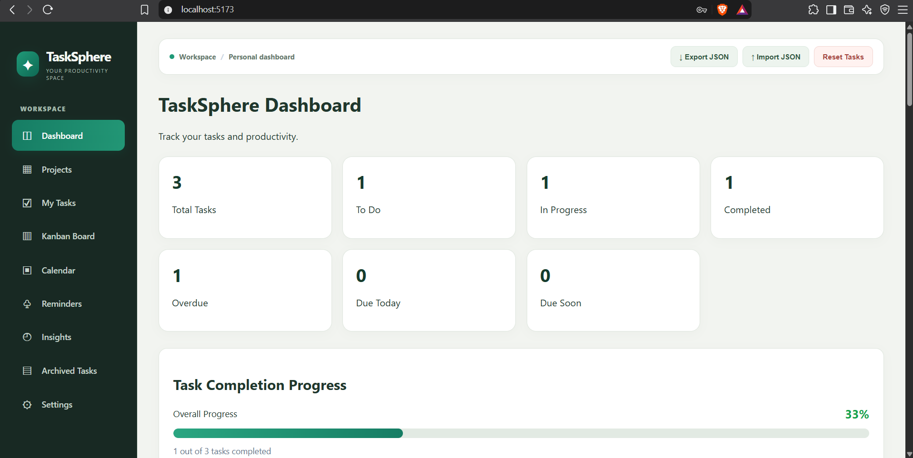
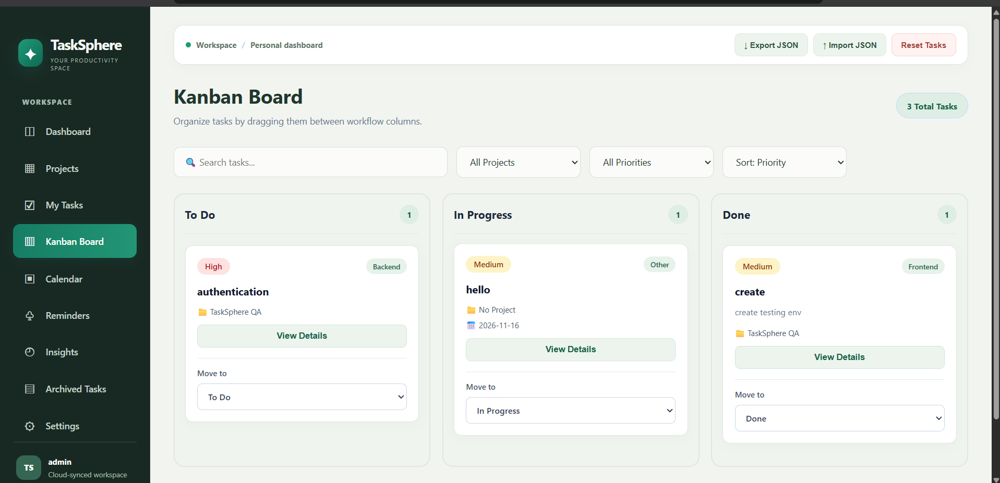
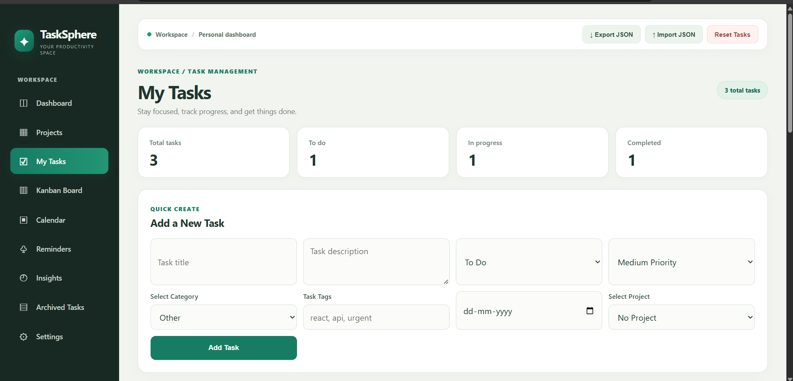

# 🚀 TaskSphere — Full-Stack Task Management Application

**A modern, full-stack productivity platform for organizing tasks, managing projects, tracking progress, and streamlining daily workflows.**

TaskSphere combines a responsive React frontend with a Node.js and Express backend, MongoDB persistence, and JWT-based authentication to provide personalized task management workspaces.


## 📌 Overview

TaskSphere is designed to help users manage their tasks and projects through an intuitive, centralized workspace.

Instead of switching between separate tools for planning, tracking, and reviewing work, users can access multiple productivity features in one application.

The platform supports account-specific task management, project organization, visual workflows, calendar-based planning, and productivity insights.

### Key Highlights

- Full-stack application with REST API integration
- Secure, account-specific workspaces using JWT authentication
- Persistent task and project data with MongoDB
- Multiple task visualization modes
- Productivity insights and task summaries
- Search, filtering, and bulk task operations
- Task archiving and JSON data import/export

---

## ✨ Features

### 🔐 Authentication & User Accounts

- User registration and login
- JWT-based authentication
- Protected application routes
- Account-specific task and project data

### ✅ Task Management

- Create, view, update, and delete tasks
- Organize tasks using status, priority, and due dates
- Search and filter tasks
- Perform bulk task actions
- Archive tasks and access archived records
- Import and export task data in JSON format

### 📁 Project Management

- Create and manage projects
- Organize related tasks into projects
- Track project-associated work

### 📊 Dashboard & Insights

- Centralized dashboard
- Task summaries and productivity statistics
- Task progress monitoring
- Dedicated insights section

### 🗂️ Kanban Board

- Visualize tasks in workflow columns
- Organize tasks by their current status
- Monitor pending, ongoing, and completed work

### 📅 Calendar

- View tasks in a calendar interface
- Plan work around deadlines
- Track upcoming tasks

### 🔔 Notifications & Reminders

- Dedicated notifications section
- Task reminder functionality
- Visibility into important upcoming work

### ⚙️ Additional Functionality

- Settings interface
- Archived task management
- Responsive application layout
- JSON import and export

---

## 📸 Application Screenshots

### 1. Dashboard

View task summaries, productivity information, and an overview of your workspace.



### 2. Kanban Board

Visualize tasks across workflow stages and track their progress.



### 3. Task Management

Create, organize, search, and manage tasks from a centralized interface.



---

## 🛠️ Tech Stack

| Category | Technologies |
|---|---|
| Frontend | React 19, TypeScript, Vite |
| Styling | CSS |
| Backend | Node.js, Express.js |
| Database | MongoDB, Mongoose |
| Authentication | JWT |
| API | REST |
| Package Management | npm |
| Version Control | Git, GitHub |
| Development Tools | VS Code |

---

## 🏗️ System Architecture

TaskSphere follows a client-server architecture.

```text
                  ┌─────────────────────┐
                  │        User         │
                  └──────────┬──────────┘
                             │
                             ▼
                  ┌─────────────────────┐
                  │   React Frontend    │
                  │  TypeScript + Vite  │
                  └──────────┬──────────┘
                             │
                        HTTP / REST
                             │
                             ▼
                  ┌─────────────────────┐
                  │   Express Backend   │
                  │       Node.js       │
                  └──────────┬──────────┘
                             │
                  ┌──────────┴──────────┐
                  │                     │
                  ▼                     ▼
          ┌───────────────┐    ┌────────────────┐
          │ JWT-based     │    │ MongoDB        │
          │ Authentication│    │ Mongoose       │
          └───────────────┘    └────────────────┘
```

### Application Workflow

1. Users register or log in through the frontend.
2. The backend authenticates users and manages protected API requests.
3. Users create and organize tasks and projects.
4. Application data is stored in MongoDB.
5. The frontend retrieves and displays account-specific information.
6. Users interact with tasks through dashboard, list, Kanban, and calendar views.

---

## 📂 Project Structure

```text
TaskSphere/
│
├── backend/
│   ├── server.js
│   ├── package.json
│   └── package-lock.json
│
├── frontend/
│   ├── public/
│   ├── src/
│   │   ├── assets/
│   │   ├── auth/
│   │   ├── components/
│   │   ├── pages/
│   │   ├── types/
│   │   ├── utils/
│   │   ├── App.tsx
│   │   └── main.tsx
│   ├── index.html
│   ├── package.json
│   └── vite.config.ts
│
├── screenshots/
│   ├── dashboard.png
│   ├── kanban.png
│   └── tasks.png
│
├── .gitignore
└── README.md
```

The `screenshots/` directory contains images used in the project documentation.

---

## 🚀 Getting Started

### Prerequisites

Before running TaskSphere locally, ensure you have:

- Node.js 22 or later
- npm
- MongoDB running locally or a MongoDB Atlas database
- Git

### 1. Clone the Repository

```bash
git clone https://github.com/Aahana0212/TaskSphere.git
cd TaskSphere
```

### 2. Configure the Backend

Navigate to the backend directory:

```bash
cd backend
npm install
```

If `backend/.env.example` is available, copy it to `.env`:

```powershell
Copy-Item .env.example .env
```

Configure the MongoDB connection string and JWT secret in `.env`.

For example, if your backend uses the following environment variable names:

```dotenv
MONGODB_URI=your_mongodb_connection_string
JWT_SECRET=your_strong_random_secret
```

Use the exact environment variable names expected by your backend code.

**Security:** Never commit `.env` files, database credentials, or JWT secrets to GitHub.

### 3. Start the Backend

```bash
npm run dev
```

The backend must be running before testing features that require API access.

### 4. Install Frontend Dependencies

Open a second terminal:

```bash
cd TaskSphere/frontend
npm install
```

If your terminal is already inside the backend folder, use:

```bash
cd ../frontend
npm install
```

### 5. Start the Frontend

```bash
npm run dev
```

Open the URL displayed by Vite, typically:

```text
http://localhost:5173
```

Ensure the frontend API configuration points to your running backend.

---

## 🔒 Security Considerations

TaskSphere uses JWT-based authentication to protect user-specific application functionality.

Security-related practices include:

- Authentication for protected application features
- User-specific data access
- Environment-based configuration for sensitive credentials
- Excluding `.env` files from version control

Production deployment should additionally use HTTPS, secure CORS settings, strong JWT secrets, and appropriate database access restrictions.

---

## 🧪 Testing

The application can be manually tested using the following workflows:

| Test Area | Expected Behavior |
|---|---|
| Registration | New users can create accounts |
| Login | Registered users can authenticate |
| Task Creation | Tasks are saved successfully |
| Task Editing | Task changes persist |
| Task Deletion | Tasks can be removed |
| Projects | Tasks can be organized by project |
| Kanban | Tasks appear in their respective workflow stages |
| Calendar | Date-associated tasks are displayed |
| Archive | Archived tasks remain accessible |
| Search & Filters | Relevant tasks can be located |
| Import & Export | Task data can be transferred through JSON |

Automated test coverage and CI/CD integration are potential future improvements.

---

## 🌐 Deployment

## 🌐 Live Demo

🚀 **Live Application:** https://task-sphere-tau.vercel.app

🔗 **Backend API:** https://tasksphere-rp77.onrender.com

💻 **GitHub Repository:** https://github.com/Aahana0212/TaskSphere

---

## 🔮 Future Enhancements

- Real-time team collaboration
- Shared workspaces and task assignments
- Advanced productivity analytics
- Email and push notification integrations
- Automated unit and integration tests
- CI/CD deployment workflows
- Enhanced mobile experience

---

## 👩‍💻 Author

**Ahana Singh**

B.Tech — Computer Science and Engineering

GitHub: [Aahana0212](https://github.com/Aahana0212)

Project Repository: [TaskSphere](https://github.com/Aahana0212/TaskSphere)

---

⭐ If you find this project useful, consider starring the repository.

**Built with React, TypeScript, Node.js, Express, and MongoDB.**
